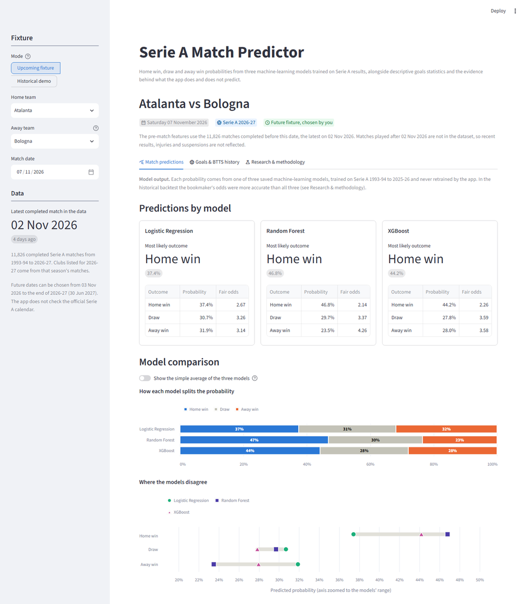
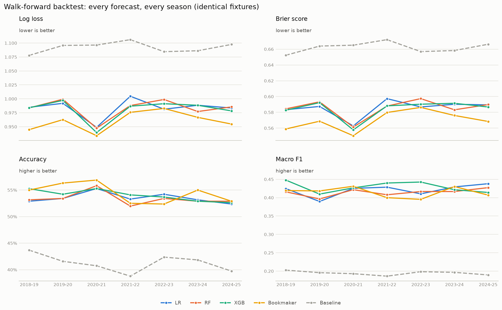
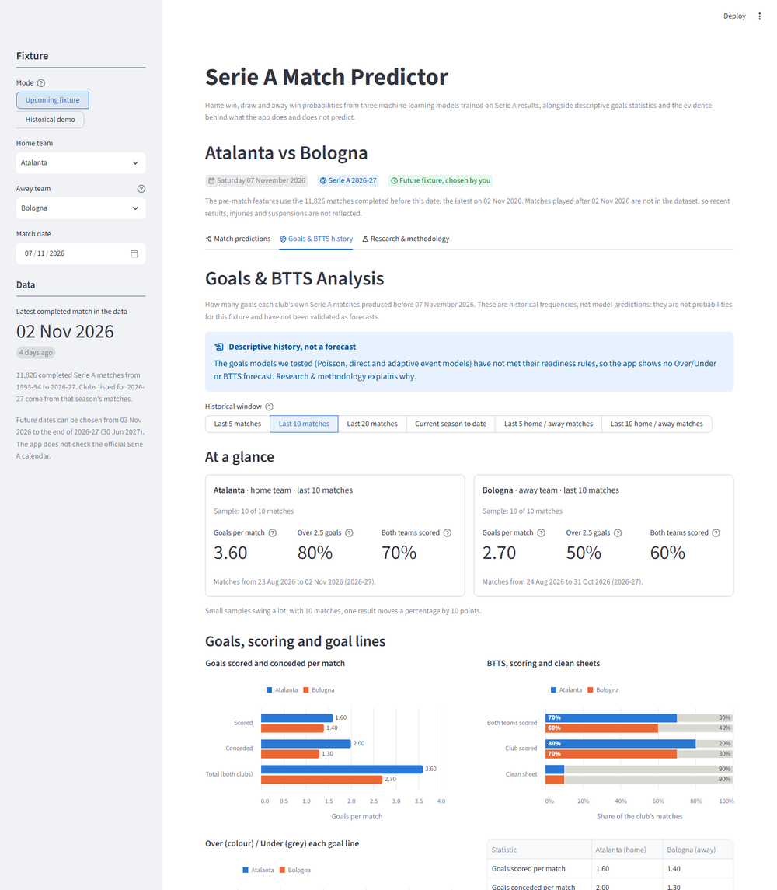
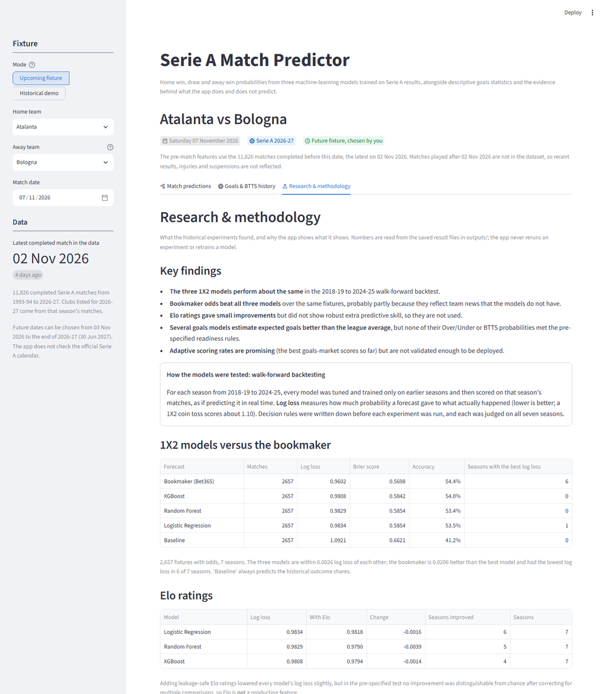

# Serie A Match Predictor

Probabilities for Italian Serie A results (home win, draw or away win) from three machine-learning models trained on 33 seasons of historical results. The models are compared honestly with a simple baseline and with bookmaker odds, and a series of experiments, each with a decision rule fixed in advance, tests whether Elo ratings or goals models add anything. A Streamlit app shows the predictions next to each club's goals history and the research evidence.



> **Not betting advice.** These are statistical estimates from past results. The models do not know about injuries, line-ups or transfers. On historical seasons they are less accurate than the bookmaker's odds, and no betting strategy or profit analysis is included.

## The project in one minute

Can thirty years of results predict a football match? Partly, and the interesting part is *how far*:

- **The models work:** using only 50 leakage-safe pre-match features, three models beat a historical-frequency baseline by about 0.11 log loss in every one of seven seasons replayed as if live.
- **The algorithm hardly matters:** Logistic Regression, Random Forest and XGBoost give almost identical probabilities (correlation 0.97–0.98).
- **The bookmaker is better:** first in 6 of 7 seasons, by about 0.02 log loss. The gap probably reflects information the models don't have, such as team news and transfers.
- **Promising ideas, honestly tested:** Elo ratings, recency weighting and several goals models gave small or unconfirmed gains. Because each had a decision rule written before it ran, none was deployed.

Read the **[project story](docs/project_story.md)** for the full narrative in plain language, see the **[presentation](docs/presentation/serie_a_match_predictor.pptx)** (12 slides with speaker notes), its **[outline](docs/presentation_outline.md)** and the **[visual guide](docs/visual_guide.md)**.

**Contents:** [In one minute](#the-project-in-one-minute) · [Research questions](#research-questions) · [Data](#data) · [The 1X2 models](#the-1x2-models) · [Results](#results) · [Further experiments](#further-experiments) · [The Streamlit app](#the-streamlit-app) · [Getting started](#getting-started-windows) · [Reproducing the research](#reproducing-the-research) · [Testing](#testing-and-continuous-integration) · [Project structure](#project-structure) · [Limitations](#limitations) · [Future work](#future-work)

The full methodology, every decision rule and all detailed results are in **[docs/methodology.md](docs/methodology.md)**. The README below covers the evidence in brief and everything needed to install, run, test and reproduce the project.

## Research questions

| Question | Short answer |
|---|---|
| Can pre-match team statistics predict 1X2 results better than a naive baseline? | Yes. All three models clearly beat a baseline that gives every match the historical outcome frequencies (its single pick is always a home win), on every metric and in every season tested. |
| Does a more flexible model (Random Forest, XGBoost) beat Logistic Regression? | No. The three models score within 0.003 log loss of each other, which is within the noise. |
| How do the models compare with the bookmaker? | Bet365's implied probabilities are better: by about 0.02 log loss in the walk-forward backtest, and first in 6 of 7 seasons. |
| Should recent seasons count more in training? | No strategy beat equal weighting by more than the uncertainty. |
| Do Elo ratings add information? | Small gains that were not statistically confirmed, so Elo is not used. |
| Can we forecast goals, Over/Under 2.5 and both teams to score (BTTS)? | Expected goals, yes. Over/Under and BTTS probabilities, not reliably: no method met its pre-specified readiness rule. |

## Data

- **Source:** [Football-Data.co.uk](https://www.football-data.co.uk/italym.php), which publishes one CSV per Serie A season with results, match statistics and bookmaker odds. Many thanks to Football-Data for making it freely available.
- **Coverage:** 34 seasons, from 1993-94 to the 2026-27 season in progress: 11,826 completed matches. The published results use the data downloaded on 5 November 2026, whose latest match was played on **2 November 2026**.
- **What is used:** dates, clubs and full-time scores to build the features. Bet365 and market-average odds (from 2002-03 and 2005-06) are used **only as a benchmark**, never as model inputs.
- **Not in the repository:** the CSVs are downloaded by `python -m src.data_loader` and are git-ignored, so a fresh clone contains no data. Football-Data does not guarantee the correctness of its data; see its [disclaimer](https://www.football-data.co.uk/disclaimer.php) and the [column notes](https://www.football-data.co.uk/notes.txt).

Preprocessing (`src/preprocessing.py`) standardises the season files: it handles ragged rows, two date formats, renamed odds columns and byte-order marks, validates the result, and writes one row per match. The [methodology](docs/methodology.md#data) lists every column.

## The 1X2 models

**Features.** `src/feature_engineering.py` builds **50 pre-match features**, 25 for each club:

- recent form over 5 and 10 matches;
- home or away form;
- season-to-date points and goals;
- last season's record;
- a promoted-club flag.

Every feature uses only matches from **strictly earlier dates**, so a match never sees its own result or other results from the same day. Unit tests check this, including a test that changes later results and confirms that earlier features stay the same. Missing history (promoted clubs, early-season matches) stays missing in the feature table instead of becoming zero; Logistic Regression and Random Forest impute it and add missing-value indicators, XGBoost handles it natively, and no match is dropped.

**Models.** Three classifiers share the features, data splits and metrics:

| Model | Pipeline | Selected settings |
|---|---|---|
| Logistic Regression | median imputer with missing-value indicators → standard scaler → L2-regularised multinomial regression | compact 22-feature set, `C = 0.001` |
| Random Forest | median imputer with indicators → 400 trees | compact set, depth 12, 10 matches per leaf |
| XGBoost | gradient-boosted trees, missing values handled natively | compact set, depth 2, 250 trees |

The app shows the three models side by side rather than choosing one, because none is better than the others.

**Evaluation design.** The data is split strictly by time:

| Step | Seasons | Purpose |
|---|---|---|
| Train | 1993-94 to 2024-25 | fit the candidate settings |
| Validate | 2025-26 (380 matches) | choose the feature set and hyperparameters by log loss |
| Final fit | 1993-94 to 2025-26 | refit the chosen settings; these are the saved models the app uses |
| Test | 2026-27, completed matches only (100 by 2 November 2026) | never used for training or tuning |
| Walk-forward backtest | each of 2018-19 to 2024-25 | for each season, retune and refit on the seasons before it only |

One season is a small sample, so the walk-forward backtest gives the steadier comparison: seven seasons, 2,657 fixtures, and every forecast scored on exactly the same matches.

**How this was developed (transparency).**

- **Retrospective development:** every season used here had already been played when the project was built, so the whole analysis is retrospective.
- **Exploratory analysis saw every season:** notebooks 01 and 02 explored all seasons, including 2025-26 and 2026-27, before the models were designed.
- **2025-26 was used for tuning:** the saved models' settings and the tuning grids were chosen on it, so 2025-26 results are not an independent test.
- **2026-27 was initially held out:** it was scored once the models were final, and those test numbers are published unchanged. They have been visible since, so any future model change judged on them would no longer be a clean test. Later experiments do not use 2025-26 or 2026-27 at all, and the code refuses them.
- **The backtest seasons were reused:** several experiments ran on the same 2018-19 to 2024-25 seasons. Each had a decision rule written before it ran, but the experiments taken together are exploratory, not independent confirmation.

## Results

**Walk-forward backtest (2018-19 to 2024-25, 2,657 identical fixtures):**

| Forecast | Pooled log loss | Pooled Brier | Pooled accuracy | Seasons ranked 1st |
|---|---|---|---|---|
| Logistic Regression | 0.983 | 0.585 | 53.5% | 1 |
| Random Forest | 0.983 | 0.585 | 53.4% | 0 |
| XGBoost | 0.981 | 0.584 | 54.0% | 0 |
| Bookmaker (Bet365) | **0.960** | **0.570** | **54.4%** | 6 |
| Baseline (historical frequencies; always picks home) | 1.092 | 0.662 | 41.2% | 0 |



**Saved models on 2025-26 and 2026-27:**

| Season | Forecast | Accuracy | Log loss | Brier |
|---|---|---|---|---|
| Validation 2025-26 (380 matches) | Logistic Regression | 51.8% | 1.002 | 0.599 |
| | Random Forest | 52.9% | 1.003 | 0.601 |
| | XGBoost | 51.6% | 1.005 | 0.602 |
| | Bookmaker (Bet365) | **53.9%** | **0.982** | **0.584** |
| | Baseline | 38.9% | 1.102 | 0.669 |
| Test 2026-27 (100 matches) | Logistic Regression | 60.0% | **0.882** | 0.508 |
| | Random Forest | **63.0%** | 0.895 | 0.518 |
| | XGBoost | 61.0% | **0.882** | **0.508** |
| | Bookmaker (Bet365) | **63.0%** | 0.898 | 0.520 |
| | Baseline | 47.0% | 1.060 | 0.640 |

What the results show:

- **Better than the baseline:** all three models clearly beat it, in every backtest season and on validation and test.
- **The models are equivalent:** pooled differences are at most 0.003 log loss, and their paired bootstrap intervals include zero. Their home-win probabilities correlate at 0.97–0.98, so the information in the features, not the choice of algorithm, limits accuracy.
- **The bookmaker is better:** it beats every model by 0.021–0.023 pooled log loss (95% intervals about +0.013 to +0.031) and ranks first in 6 of 7 seasons. On the 100-match test sample the models score slightly better, but the intervals are far too wide to separate any of the forecasts, so this is **not** evidence that the models beat the market.
- **Draws are almost never the top pick:** Logistic Regression's draw probabilities, for example, stay between about 12% and 40%. The probabilities are reasonably calibrated, but a draw is rarely any forecast's single most likely outcome, the bookmaker's included: draws are hard to identify in advance.

Probability calibration, bootstrap intervals and per-season results are in the [methodology](docs/methodology.md#probability-calibration-and-bookmaker-benchmark).

## Further experiments

Each experiment ran on the walk-forward seasons with a decision rule written **before** it was run. None changed the production models.

| Experiment | Result | Decision |
|---|---|---|
| [Recency weighting](docs/methodology.md#recency-weighting-experiment): rolling windows and exponential decay for Logistic Regression | No strategy beat equal weighting by more than the uncertainty; the best (5-year half-life) gained about 0.003 log loss | Keep equal weights |
| [Elo ratings](docs/methodology.md#elo-rating-experiment) added to all three models | Pooled log loss 0.0014–0.0039 lower, but no Bonferroni-adjusted interval excludes zero; the Elo gap mostly repeats the previous-season points gap (rank correlation 0.87) | **Not used**; Random Forest + Elo is a candidate for confirmation on new seasons |
| [Poisson goals model](docs/methodology.md#poisson-goals-model) | Expected goals 10.3% better than the league average (Poisson deviance), in all 7 seasons. Over/Under and BTTS probabilities show no demonstrated skill and are too extreme | **Not used** for forecasts |
| [Direct Over/Under and BTTS models](docs/methodology.md#direct-overunder-and-btts-experiment), and recalibrated Poisson | No comparison excludes zero; the gains rest on one high-scoring season | **Not used** |
| [Adaptive scoring rates](docs/methodology.md#adaptive-scoring-rates-experiment) that follow recent league scoring | Best pooled scores so far. For Over 2.5 the adaptive frequency passes 4 of 5 criteria but fails calibration (too timid) | **Not used**: promising, not validated |

The market's Over/Under 2.5 odds remain clearly better than every goals method (0.6786 log loss against 0.6886 for the best).

## The Streamlit app

The app (`app.py`) predicts any fixture of the current season with the three saved models. It is organised in three tabs that keep model output, descriptive history and research evidence apart:

| Tab | What it shows | What it is |
|---|---|---|
| **Match predictions** | Each model's home/draw/away probabilities, most likely outcome and fair odds; a stacked bar per model; where the models disagree | **Model output** of the three saved 1X2 models |
| **Goals & BTTS history** | Each club's recent goals per match, Over/Under, BTTS, scoring and clean-sheet shares, with sample sizes and the matches behind them | **Descriptive history**, not forecasts |
| **Research & methodology** | Backtest results against the bookmaker, the Elo and goals experiments, the documented decisions, the saved models' recent scores and the limitations | **Evidence** read from the saved results |





- **Fixtures:** choose any two clubs from the current season and a date. The app doesn't check the official calendar, and labels the fixture "chosen by you".
- **Time-safe features:** a fixture's 50 features are rebuilt from matches completed strictly before its date, using the same code as the training data. Tests check that a rebuilt historical fixture matches its saved row exactly.
- **Data freshness:**
  - the sidebar always shows the date of the latest match in the data;
  - a **Stale match data** warning appears when that date is more than 10 days old, or when the fixture is more than 10 days after it.
- **Historical demo mode:** rebuilds any past fixture as it looked that morning and shows the actual result. It warns when that season was part of the models' training data, because such a demo is not an out-of-sample forecast.
- **No experimental models:** Elo, the goals models and the adaptive rates appear only as research results; none affects a prediction.
- **Offline:** no network calls; the app never retrains a model or reruns an experiment.

The research tab reads the experiment results in `outputs/`. They are optional: if one is missing, that section says which command creates it and the rest of the app works normally. [More detail](docs/methodology.md#interactive-prediction-app).

## Getting started (Windows)

Requires **Python 3.13** or newer (`requires-python` in `pyproject.toml`): the project was developed and tested with Python 3.13 on Windows 11, and CI tests it with Python 3.13 on Ubuntu. Earlier versions are not supported. The commands below are for PowerShell, run from the project folder.

**1. Clone the repository and create a virtual environment.** The project lives in the `football-match-predictor` folder of the `DI-Bootcamp` repository.

```powershell
git clone https://github.com/elem86/DI-Bootcamp.git
cd DI-Bootcamp\football-match-predictor

py -3.13 -m venv .venv              # or: python -m venv .venv, if python is 3.13
.venv\Scripts\Activate.ps1          # in cmd.exe: .venv\Scripts\activate.bat
python -m pip install --upgrade pip
```

If PowerShell refuses to run `Activate.ps1`, allow local scripts once with `Set-ExecutionPolicy -Scope CurrentUser RemoteSigned`.

**2. Install the dependencies.**

```powershell
pip install -r requirements.txt        # minimum versions
# or, for the exact versions the published results were produced with:
pip install -r requirements-lock.txt
```

Both install the project itself in editable mode, so `import src` works from scripts, notebooks and tests.

**3. Build the data and train the models.** A fresh clone has no data or models. These four steps are required before the app can run, in this order:

```powershell
python -m src.data_loader            # download every Serie A season CSV into data/raw/ (needs internet)
python -m src.preprocessing          # data/processed/matches.csv: one row per match
python -m src.feature_engineering    # data/processed/features.csv: the 50 pre-match features
python -m src.train                  # outputs/models/ and outputs/predictions/: the three saved models
```

This takes about 3 minutes in total, most of it training. Downloading takes under a minute: the loader pauses between files to be polite to the site.

**4. Run the app.**

```powershell
streamlit run app.py
```

It opens at http://localhost:8501. To include the research tab's tables, also run the experiments under [Reproducing the research](#reproducing-the-research).

**5. Run the tests.**

```powershell
python -m pytest
```

**Refreshing the data.** To include matches played since your last download, run `python -m src.data_loader` (it always re-downloads the current season) and `python -m src.preprocessing` again, then restart the app. Rerun `python -m src.feature_engineering` too, so that `features.csv` stays in step for the notebooks and tests. The app caches the match data while it runs, so it won't see new files until it restarts or you choose **Clear cache** in its menu. The saved models do not need retraining for new fixtures.

### What a fresh clone contains

| Included in git | Generated locally (git-ignored) |
|---|---|
| Source code (`src/`, `app.py`), tests, notebooks with their outputs, figures (`outputs/figures/`), screenshots, documentation | **Required for the app:** `data/raw/` (downloaded CSVs), `data/processed/`, `outputs/models/`, `outputs/predictions/` |
| | **Optional research results:** `outputs/backtest/`, `recency/`, `elo/`, `goals/`, `events/`, `scoring_drift/`, `excel/` |

No dataset, trained model or experiment result is committed; every one can be rebuilt with the commands in this README.

## Reproducing the research

After step 3 of Getting started, the experiments can be rerun in this order. They are deterministic (fixed random seed), read only the processed data and earlier results, and write to their own git-ignored folders:

| Order | Command | Needs | Writes | Time* | Presented in |
|---|---|---|---|---|---|
| 1 | `python -m src.backtest` | features | `outputs/backtest/` | ~6 min | [06_walk_forward_backtesting](notebooks/06_walk_forward_backtesting.ipynb) |
| 2 | `python -m src.recency` | features | `outputs/recency/` | ~4 min | [07_recency_experiments](notebooks/07_recency_experiments.ipynb) |
| 3 | `python -m src.elo_experiment` | features | `outputs/elo/` | ~13 min | [08_elo_rating_analysis](notebooks/08_elo_rating_analysis.ipynb) |
| 4 | `python -m src.goals_backtest` | features, raw CSVs (market odds) | `outputs/goals/` | ~1 min | [09_goals_prediction_analysis](notebooks/09_goals_prediction_analysis.ipynb) |
| 5 | `python -m src.event_backtest` | features | `outputs/events/` | ~3 min | [10_event_prediction_analysis](notebooks/10_event_prediction_analysis.ipynb) |
| 6 | `python -m src.scoring_drift_backtest` | results of 4 and 5 | `outputs/scoring_drift/` | ~10 s | [11_scoring_drift_analysis](notebooks/11_scoring_drift_analysis.ipynb) |
| – | `python -m src.excel_report` | `outputs/predictions/` (from `src.train`) | `outputs/excel/serie_a_prediction_analysis.xlsx` | ~30 s | [methodology](docs/methodology.md#excel-workbook) |

\* Measured on the development laptop (Windows 11, Python 3.13). Expect up to about twice as long on a busy machine.

The research tab of the app uses the results of steps 1, 3, 4, 5 and 6, plus `outputs/models/model_comparison.csv` from `src.train`.

**Notebooks.** The numbered notebooks in `notebooks/` are committed with their outputs, so they can be read on GitHub without running anything.
- **Running them:** notebooks 03, 04, 06 and 07 rerun their experiment and save its results. Notebook 05 and notebooks 08–11 load saved results when they exist, and otherwise run the experiment.
- **Figures:** every notebook rewrites its figures in `outputs/figures/`.

**What will and won't match the published numbers:**
- **Backtests and validation:** the backtests (2018-19 to 2024-25) and the 2025-26 validation results depend only on completed seasons, so with the same library versions (`requirements-lock.txt`) they are reproduced. This was checked on a fresh clone with a new virtual environment: rerunning every command in this README rebuilt the processed data, the saved models and the recency, goals, event and adaptive-rate results byte for byte. The remaining files (the backtest and Elo results, and the Random Forest's saved predictions and metrics) differ only in the 16th significant digit (at most 3 × 10⁻¹⁶), from the order of multithreaded floating-point sums.
- **The 2026-27 test:** it uses every 2026-27 match in your data. If you download later than 2 November 2026, it covers more than 100 matches and its numbers will differ from those published here.
- **Football-Data revisions:** if Football-Data later corrects a historical file, results can change slightly.

## Testing and continuous integration

`python -m pytest` runs 436 tests in about 7 minutes with all data and results present. They check, among other things:

- **Leakage:** no feature or statistic ever sees a same-day or later result;
- **Parity:** features rebuilt for the app match the training data;
- **Metrics:** the evaluation metrics, bootstrap intervals and decision rules;
- **Excel:** the workbook's formulas;
- **The app:** checked with Streamlit's `AppTest`;
- **The repository** (`tests/test_repository.py`):
  - documented commands and links exist;
  - every imported package is a declared requirement;
  - no data, model, secret or local path is tracked.

**Without data:** tests that need downloaded data, saved models or experiment results skip themselves with a reason, so the suite still passes in a fresh clone (419 passed, 17 skipped).

**CI:** a GitHub Actions workflow ([`.github/workflows/football-match-predictor.yml`](../.github/workflows/football-match-predictor.yml) in the `DI-Bootcamp` repository root) runs on every push that touches this folder. It installs `requirements.txt` on Python 3.13 (Ubuntu), runs the test suite and checks that the Streamlit app starts. It never downloads data, trains models or runs backtests. GitHub only runs workflows from the repository root, which is why the file sits outside this folder. If the project becomes a standalone repository, move the file to its own `.github/workflows/` folder and remove the monorepo settings described at the top of the file (`paths` filters, `working-directory` and the `cache-dependency-path` prefix).

## Project structure

```
football-match-predictor/
├── app.py                  # Streamlit app (streamlit run app.py)
├── src/                    # Pipeline code; each step runs as python -m src.<module>
│   ├── config.py           #   project paths and the random seed
│   ├── data_loader.py      #   download the Football-Data CSVs
│   ├── preprocessing.py    #   standardise and validate them into matches.csv
│   ├── feature_engineering.py  # the 50 leakage-safe pre-match features
│   ├── models.py, train.py #   model definitions, tuning, final fit and test
│   ├── evaluate.py, bookmaker.py  # metrics, calibration, bootstrap; bookmaker benchmark
│   ├── predict.py          #   features and predictions for a new fixture (used by the app)
│   ├── app_support.py      #   data freshness and research summaries for the app
│   ├── goal_stats.py       #   descriptive goals and BTTS statistics
│   ├── backtest.py, recency.py, elo.py, elo_experiment.py  # walk-forward experiments
│   ├── goals_model.py, goals_backtest.py, event_models.py, event_backtest.py,
│   │   scoring_drift.py, scoring_drift_backtest.py         # goals research
│   └── excel_report.py     #   Excel workbook
├── tests/                  # pytest suite, including test_app.py (Streamlit AppTest) and test_repository.py
├── notebooks/              # 01-11: exploration, models, experiments (committed with outputs)
├── outputs/
│   ├── figures/            # charts from the notebooks (tracked)
│   └── models/, predictions/, backtest/, recency/, elo/, goals/, events/, scoring_drift/, excel/
│                           # generated results (git-ignored; folders kept with .gitkeep)
├── data/raw/, data/processed/   # downloaded and processed data (git-ignored)
├── docs/
│   ├── project_story.md    # the project as a plain-language narrative
│   ├── presentation_outline.md  # 12-slide storyboard with speaker notes
│   ├── visual_guide.md     # which figures to use, and diagrams still to make
│   ├── presentation/       # the PowerPoint, its presentation-ready figures and build scripts
│   ├── methodology.md      # full methodology and detailed results
│   └── screenshots/        # app screenshots used in this README
├── .streamlit/config.toml  # app theme and server settings (no secrets)
├── requirements.txt        # dependencies (minimum versions)
├── requirements-lock.txt   # exact versions used for the published results
└── pyproject.toml          # makes src importable (installed in editable mode)
```

## Limitations

- **Only results:** the models know nothing about line-ups, injuries, suspensions, transfers or managers. This is the most likely reason the bookmaker is better.
- **Small samples:** single seasons (380 matches), and especially the 100-match 2026-27 test, cannot separate forecasts that differ by a few thousandths of log loss.
- **Retrospective research:** see [How this was developed](#the-1x2-models). The backtest seasons informed several decisions.
- **Draws:** a draw is rarely the most likely outcome for the models or the bookmaker, so draws are hard to identify in advance.
- **Data freshness:** predictions reflect only matches up to the latest date in the downloaded data, and the app has no official fixture list.
- **Promoted clubs:** they start without Serie A history (Serie B is not in the data), so many of their features are missing early in a season.
- **Goals:** the Goals & BTTS tab shows historical frequencies, which are not validated probabilities.

## Future work

- Confirm the leading candidates on seasons they have not seen, with their settings frozen:
  - Random Forest with Elo;
  - the adaptive event frequency for Over 2.5 and BTTS;
  - a 5-year recency half-life.
- Add information the bookmaker uses: expected-goals statistics, line-ups or squad value.
- Model draws and low scores better, for example with Dixon-Coles or a bivariate Poisson model.
- Add an official fixture list so that the app can offer real upcoming matches.
- Refresh the data automatically, with a scheduled job and a check of the stale-data warning.

## Data source and disclaimer

Match data comes from [Football-Data.co.uk](https://www.football-data.co.uk/). It is downloaded by the user for personal, educational analysis and not redistributed in this repository. This project is not affiliated with Football-Data, Serie A or any bookmaker. Odds are used only to evaluate the models. Nothing here is betting advice.
