# Can thirty years of results predict a football match?

*The story of the Serie A Match Predictor: what we tried, what worked, what didn't, and why the honest answer is more interesting than a headline accuracy number.*

This is the narrative version of the project. Every number here comes from the saved results and notebooks; the full methodology, decision rules and tables are in [methodology.md](methodology.md), and setup instructions are in the [README](../README.md). A [presentation outline](presentation_outline.md) and a [guide to the figures](visual_guide.md) accompany it.

---

## 1. The question

Before every Italian Serie A match, millions of people form an opinion: will the home team win, will it be a draw, or will the visitors win? Bookmakers turn those opinions into odds, and the odds into money.

We asked a simpler, more scientific question:

> **Using only the results of past matches, how well can a machine-learning model estimate the probabilities of a home win, a draw and an away win, and how close can it get to the bookmakers?**

The word *probabilities* matters. We did not want a model that shouts "home win!" for every match. We wanted one that says "48% home win, 27% draw, 25% away win", and whose 48% really means 48%. Most of this story is about how to check that.

## 2. Collecting and understanding the data

The data comes from [Football-Data.co.uk](https://www.football-data.co.uk/italym.php), which publishes one spreadsheet per Serie A season. We downloaded **34 seasons**, from 1993-94 to the season in progress, a total of **11,826 completed matches** (the latest played on 2 November 2026). Each row holds the date, the two clubs, the score and, from 2002-03 onwards, the bookmakers' odds.

Thirty years of spreadsheets are not one tidy table. Older files have ragged rows, dates come in two formats, odds columns were renamed over the years and some files start with invisible byte-order marks. Cleaning them into one validated table was the first real job.

Then we looked at what we were trying to predict.

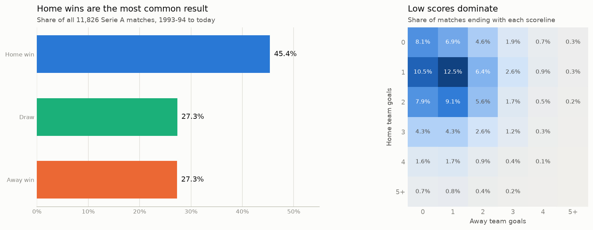

- **Home wins happen 45.4% of the time**, draws and away wins 27.3% each. A "model" that always predicts a home win is right 45% of the time, so that is the bar to clear.
- **Scores are low.** A match averages 2.66 goals, and 1-1, 1-0 and 2-1 are the most common results. When one goal often decides a match, luck plays a big part, and no model can be right most of the time.

The most important discovery was that **the game itself changes**.

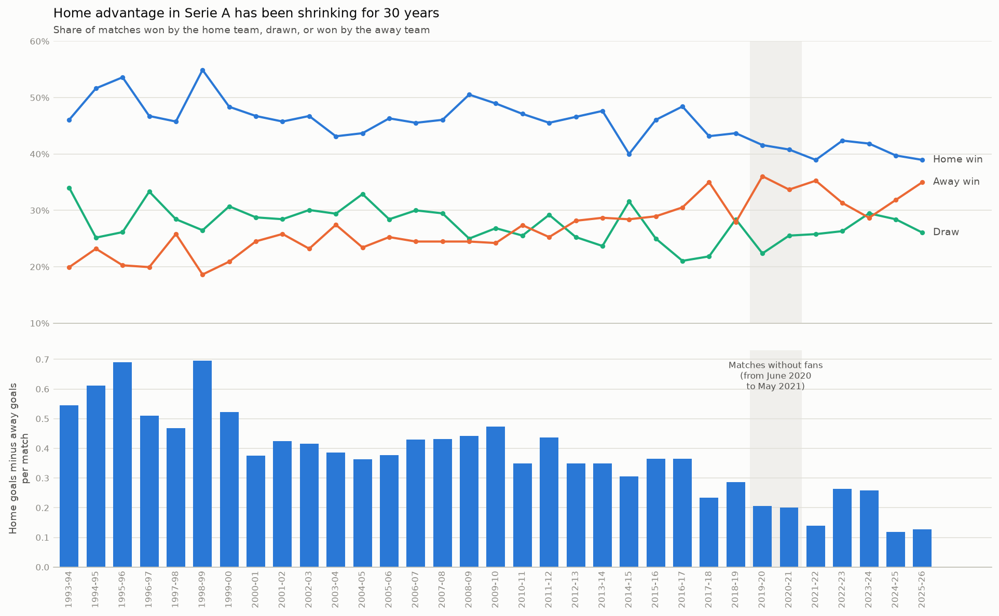

In the 1990s home teams won about half their matches and scored about 0.58 goals more than visitors. In the last five seasons home teams win about 40%, and the goal edge is under 0.2. Away wins have risen from about one in five matches to about one in three. The empty stadiums of 2020-21 had low home advantage, but the decline started long before and did not reverse when fans returned. Meanwhile the league became more unequal: the spread of points per game between clubs rose from about 0.41 in the 1990s to about 0.50 since 2016-17.

That has a practical consequence: **a model must always be tested on seasons that come after the ones it learned from**, because the past is not a perfect guide to the present.

## 3. Engineering features without peeking at the future

A model can't read a fixture list; it needs numbers. For every match we built **50 pre-match features**, 25 per club, describing how good each team looked *before kick-off*:

- recent form over the last 5 and 10 matches (points, goals scored and conceded, goal difference);
- form at home (for the home team) or away (for the visitors);
- points and goals so far this season;
- last season's points and goal difference;
- whether the club was just promoted, and how many Serie A matches it has played in its current spell.

These simple numbers carry real signal. When the home team's recent form is much better than the visitor's, home wins become far more common:

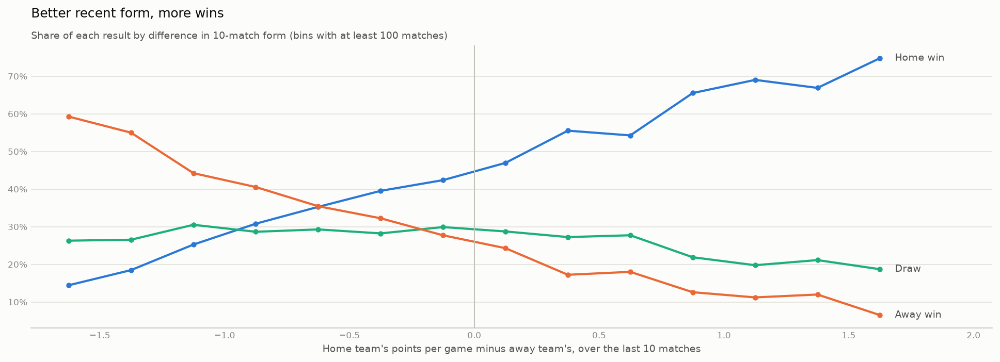

Notice the green line: **draws stay between about 19% and 31% whatever the form gap**. That is a first hint that draws will be very hard to predict.

> **Concept: data leakage.** Leakage is when a model accidentally gets information it would not have in real life. Suppose the feature "goal difference this season" for a match on 10 January included the result of that very match. The model would look brilliant in testing, because the answer is hidden in the question, and useless in reality. Leakage is the most common way data science projects fool themselves.

Our rule was strict: **every feature uses only matches played on earlier dates.** A match never sees its own result, or even other results from the same day. Automated tests check this, including one that changes later results and confirms that earlier features don't move. A promoted club arriving from Serie B (which is not in the data) starts with no history, and the gap is left visible rather than filled with a made-up number.

## 4. Three models

We trained three well-known classifiers on the same features:

- **Logistic Regression**, a linear model that adds up evidence for each outcome;
- **Random Forest**, hundreds of decision trees that vote;
- **XGBoost**, trees built one after another, each correcting the last.

The data was split strictly by time: train on 1993-94 to 2024-25, use **2025-26 to choose the settings** (the *validation* season), then refit on everything up to 2025-26 and test on **the 2026-27 matches played so far**, which the models never saw.

> **Concept: overfitting.** A model that memorises its training data instead of learning general patterns is *overfitted*, like a student who memorises last year's exam answers and fails this year's paper. With noisy data like football, the defence is simplicity: the selected Logistic Regression uses a compact set of 22 features and very strong regularisation (a penalty on large coefficients), and the best XGBoost uses trees only two levels deep.

The surprise was how little the algorithm mattered.

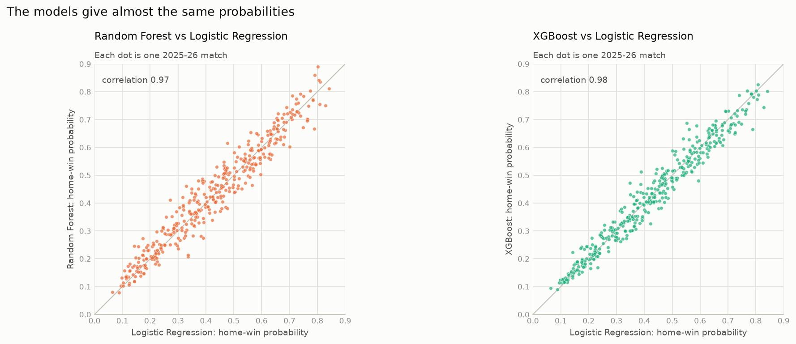

The home-win probabilities of the three models correlate at 0.97–0.98, and they agree on the predicted outcome for about 88% of validation matches. The tree models, which can find complex non-linear patterns, found nothing extra. All three lean on the same thing: how strong each team has been, last season and this season.

On the validation season, the three models were 51.6–52.9% accurate against 38.9% for "always home win", and on the first 100 matches of 2026-27, 60–63% against 47%. But accuracy only checks the single most likely outcome, and that turned out to be the wrong way to judge a forecast.

## 5. Judging forecasts fairly: chronological walk-forward testing

### How do you score a probability?

> **Concept: log loss.** For each match, take the probability the model gave to *what actually happened*, and score it as −log(probability). A confident correct call scores near 0. A 50% call scores 0.69. A 10% call that comes true scores 2.30: confident mistakes are punished hard. Averaged over many matches, **lower is better**. Giving every outcome one third scores 1.099.

> **Concept: calibration.** A forecast is *calibrated* if its numbers mean what they say: of all the matches where it says "40% home win", about 40% should end in home wins. It is the same test you would apply to a weather forecaster who says "40% chance of rain".

Two forecasts can pick exactly the same winners and still differ in quality: if home teams in a certain situation win 60% of the time, a model that says 60% is better than one that says 90%, even though both "predict a home win".

### One season is not enough

A single season of 380 matches is a small sample, and a 100-match test even smaller (its accuracy is only known to within about ±10 points). So we built a **walk-forward backtest**: we replayed seven seasons, 2018-19 to 2024-25, as if we were living through them.

```
For each season S from 2018-19 to 2024-25:

  1993-94 ............................. S-2 | S-1      | S
  [ fit candidate settings on these seasons ] [ choose ] [ predict, then score ]
  [ refit the chosen settings on everything up to S-1  ] [ predict S           ]

  Seasons after S are hidden. S is only used for scoring.
```

Each season is predicted by a model that only knew the seasons before it, and that chose its own settings using only the past. Every forecast was scored on the same **2,657 matches** (the ones with bookmaker odds).

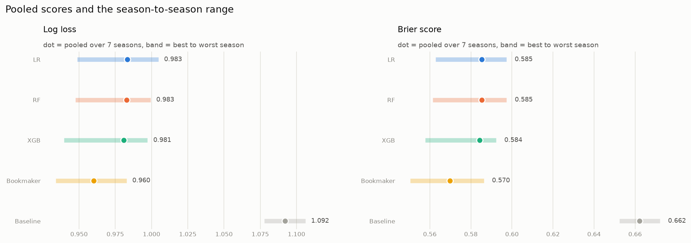

| Forecast | Log loss (lower is better) | Accuracy |
|---|---|---|
| Always home win (baseline) | 1.092 | 41.2% |
| Logistic Regression | 0.983 | 53.5% |
| Random Forest | 0.983 | 53.4% |
| XGBoost | 0.981 | 54.0% |
| Bookmaker (Bet365) | **0.960** | **54.4%** |

The models beat the baseline by about 0.11 log loss **in every one of the seven seasons**. They are genuinely useful. But between themselves, the differences are at most 0.003, and seasons vary far more (each model's score moves by 0.05–0.06 from one season to the next) than models do.

> **Concept: uncertainty.** A difference of 0.003 might be skill, or luck in which matches happened to be played. To find out, we used a *paired bootstrap*: resample the 2,657 matches with replacement 10,000 times, recompute the difference each time, and see how much it wobbles. The middle 95% of those values is a 95% interval. If it includes zero, the data can't tell the forecasts apart. For the three models, every interval included zero.

### A note on honesty

Good evaluation is also about being clear on what was *not* a clean test:

- **Everything is retrospective.** Every season had already been played when this project was built.
- **The exploratory notebooks looked at every season**, including 2025-26 and 2026-27, before the models were designed.
- **2025-26 was used for tuning**, so its scores are not an independent test.
- **2026-27 was held out at first** and scored once the models were final. Those results are published unchanged, but they have been visible since, so they can no longer judge a *new* model fairly.
- **The seven backtest seasons were reused** by every later experiment. Each experiment had a decision rule written before it ran, but taken together they are exploration, not independent confirmation.

## 6. The benchmark: the bookmaker

Bookmakers' odds can be turned into probabilities: the probability of an outcome is roughly 1 / odds. Those numbers add up to slightly more than 100%, because the bookmaker builds in a margin, so we rescaled them to sum to exactly 100%. The odds were used **only as a benchmark**, never as an input to the models.

The result is the most important finding of the project:

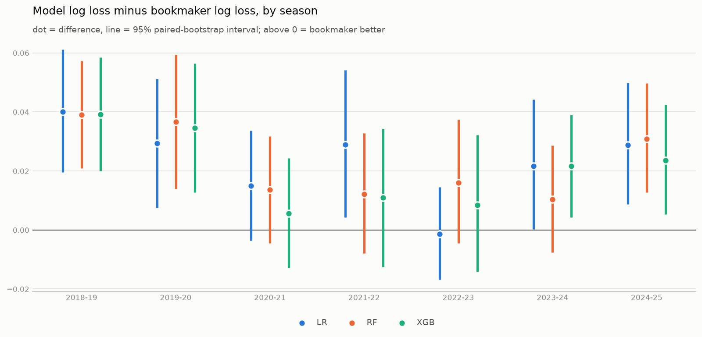

**The bookmaker was better in 6 of 7 seasons**, by 0.021–0.023 log loss over all seven. The 95% intervals (about +0.013 to +0.031) exclude zero, so this is not luck. The bookmaker's lead is about a fifth of the distance the models travelled from the naive baseline.

Why? The models' home-win probabilities correlate with the bookmaker's at about 0.92–0.93, so they recover most of what the market knows about team strength. On the 2025-26 validation season, the biggest disagreements were about **promoted clubs** (the models have no Serie A history for them; the bookmaker knows their squads and transfers), **the last rounds of the season** (motivation and squad rotation) and **big matches**. The models only know results. The bookmaker also knows about injuries, line-ups, transfers and where the money is going. Interestingly, the bookmaker's probabilities are no bolder than the models': it simply puts the confidence on the right matches more often.

What about the 2026-27 test, where the models scored slightly better than the bookmaker (0.882 against 0.898)? With only 100 matches the intervals are far too wide to separate any of the forecasts. It is **not** evidence that the models beat the market, and we don't present it that way.

> **The lesson:** with these features, the choice of algorithm hardly matters. Closing the gap would need *new information*, not a cleverer model.

## 7. Do Elo ratings add anything?

Elo ratings, invented for chess, are the classic way to rate teams. Every club starts at 1500; after each match the winner takes points from the loser, more if the result was a surprise. Ratings carry over from season to season, with a pull back toward the average every summer.

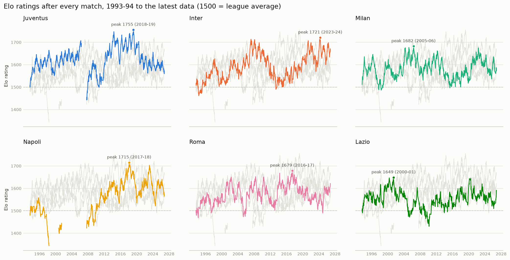

We built leakage-safe ratings (a match only uses ratings from results before its date) with fixed, untuned settings, added three Elo columns to the features, and reran the full seven-season backtest for all three models. The decision rule was written down before the run: Elo would only be adopted if its improvement was statistically clear after correcting for testing three models, appeared in at least 5 of 7 seasons and survived leaving out any one season.

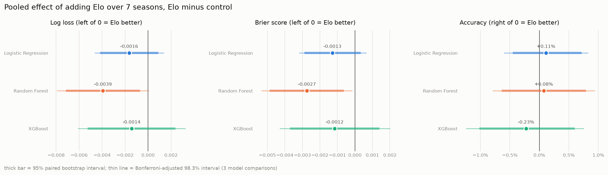

- Every model's log loss got **slightly** better, by 0.0014 to 0.0039.
- For Random Forest, the ordinary 95% interval excluded zero, but **after the correction for testing three models it did not** (its upper end was +0.0001).
- Accuracy did not improve, and there was no special benefit for promoted clubs.
- The likely reason: the Elo gap between two clubs has a rank correlation of 0.87 with the gap in last season's points, which the models already had.

**Decision: Elo is not used.** Random Forest with Elo remains a candidate to confirm on seasons the experiment has not seen. This is a good example of why the rule was written in advance: "better in every model" sounds convincing, but the effect is about a tenth of the gap to the bookmaker and not statistically confirmed.

## 8. Does recent history matter more?

Since home advantage and scoring have changed over time, maybe old seasons mislead the model. We tested six alternatives to treating all seasons equally: training only on the last 3, 5 or 10 seasons, or down-weighting older matches so that a match counts half as much every 1, 2 or 5 years.

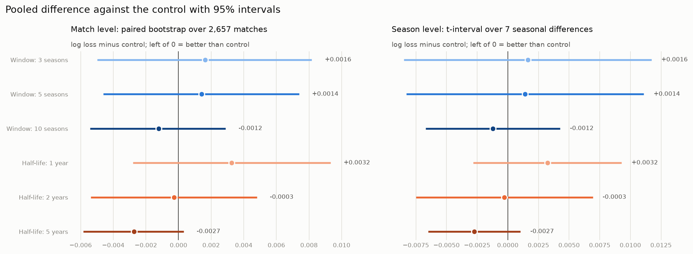

- **Shorter memory was worse.** Windows of 3–5 seasons and a 1-year half-life threw away too much data.
- **A 5-year half-life was the best**: better in 6 of 7 seasons, by 0.0027 log loss. But its intervals reach zero, and it was the best of six strategies tried on the same seasons.

That last point matters. If you try six ideas on the same seven seasons, the best one will look good partly by luck. **Decision: keep equal weights**, and treat the 5-year half-life as a candidate to check on new seasons.

## 9. From results to goals: expected goals, Over/Under and BTTS

Many people care less about who wins than about goals: will there be more than 2.5 goals (**Over 2.5**), and will **both teams score** (**BTTS**)? Goal counts in football follow a well-known pattern, the Poisson distribution, so a classic approach is to estimate each team's *expected goals* and derive every goal probability from them.

We compared three ways of estimating expected goals over the seven seasons: the league average, each team's recent attack and defence, and a Poisson regression on our features.

- **Expected goals: clear skill.** The Poisson regression was 10.3% better than the league average (Poisson deviance 2.147 against 2.394), in all seven seasons.
- **Over/Under and BTTS probabilities: no demonstrated skill.**

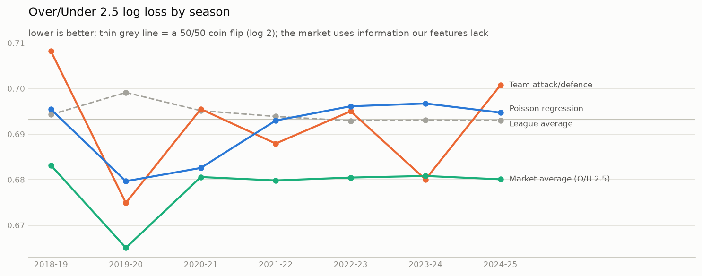

The thin grey line is a 50/50 coin flip (log loss 0.693). Our goal models hover around it, at 0.6912 for the best, while the market's Over/Under odds sit clearly below at 0.6786. Their probabilities were also **too extreme**: when the model said 70%, it happened less often than that. And the models under-predicted both-teams-to-score by 3.8 points and draws by 3.2 points.

Being able to estimate *how many* goals is not the same as giving reliable probabilities for *yes/no* questions about them. The models failed every part of their readiness rule, so **the app shows no goal forecasts**. Its Goals & BTTS tab shows only historical frequencies, clearly labelled as descriptive, not predictive.

## 10. Fixing the goals probabilities: recalibration and adaptive scoring rates

Two more attempts tried to rescue the goals probabilities.

**Direct models and recalibration.** We trained a classifier directly on each yes/no event, and separately *recalibrated* the Poisson probabilities, learning a correction from earlier seasons' mistakes. The best Over 2.5 method (recalibrated Poisson, 0.6908) and the best BTTS method (direct logistic, 0.6877) were only marginally better than simply using the historical frequency, and their gains disappeared when the high-scoring 2019-20 season was left out. Every method was still too extreme.

**Adaptive scoring rates.** The deeper problem turned out to be **drift**: the league's scoring level moves from season to season, and older seasons no longer describe today's league.

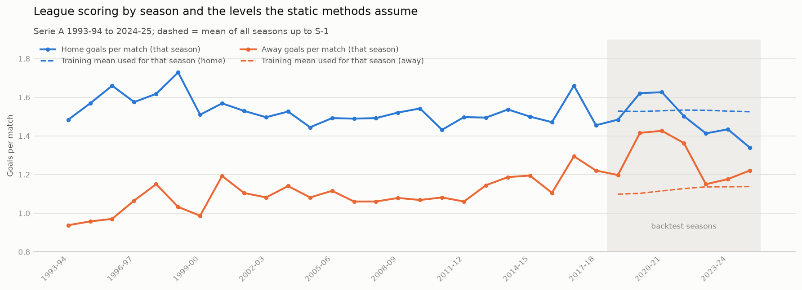

Goals per match jumped from 2.68 in 2018-19 to 3.04 and 3.05 in 2019-20 and 2020-21, then fell back to about 2.56–2.61. Away scoring has been above its long-run average throughout. A forecaster anchored to the 1993-onward average is off in a structural direction.

So we tested methods that follow the last 200 completed league matches, gently pulled toward history:

- They achieved the **best pooled scores of any method so far** (Over 2.5: 0.6887 for the adaptive frequency; BTTS: 0.6863).
- For Over 2.5, the adaptive frequency passed four of five criteria: a clear gain over the static frequency (an interval below zero even after correcting for 8 comparisons), better in 6 of 7 seasons, robust to leaving out a season.
- It **failed calibration**: it moved in the right direction but by too little ("too timid").
- For BTTS, its interval just touched zero (+0.0001) and it won only 4 of 7 seasons.

**Decision: not deployed.** This is our most promising result for goals, but it is exploratory: these seasons had already shaped the hypothesis. The fair next step is to apply the same method, with the same fixed settings, to seasons it has never seen. And even the best goals method is still well behind the market (0.6886 against 0.6786 on Over 2.5).

## 11. The interactive app

The findings come together in a Streamlit app with three tabs that keep three kinds of content apart:

- **Match predictions:** pick two clubs and a date, and see each model's probabilities, the fair odds they imply, and where the models disagree. The fixture's 50 features are rebuilt from matches before its date, with the same code as the training data.
- **Goals & BTTS history:** each club's recent goals record, clearly labelled as history, not forecasts.
- **Research & methodology:** the evidence in this story, read from the saved result files, including why Elo and the goals models are *not* used.

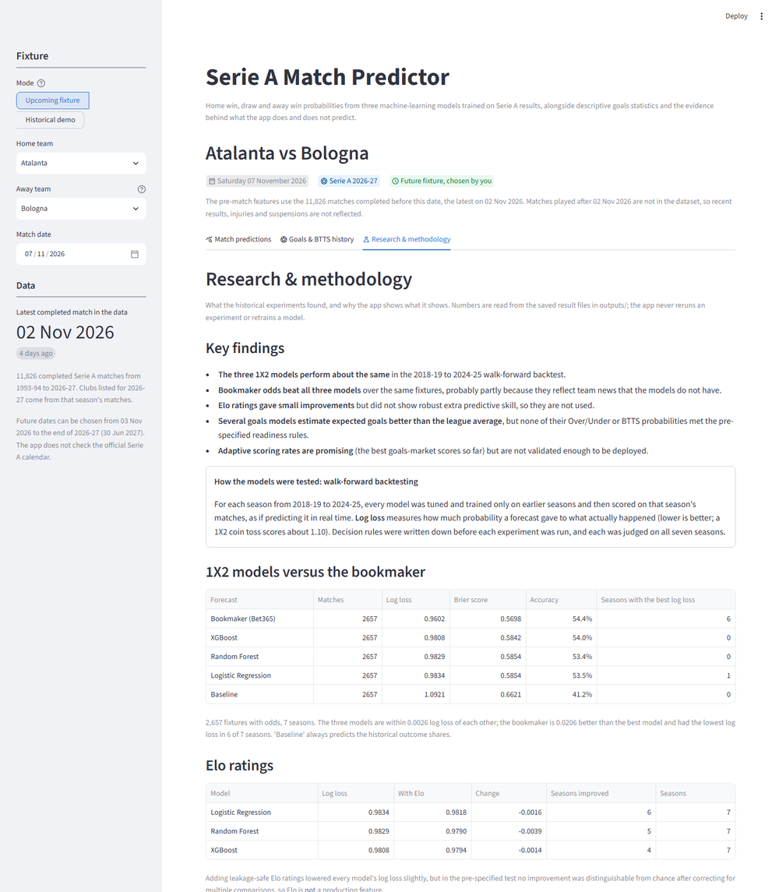

The app is honest about its limits. It shows the date of the latest match in the data and warns when that is more than 10 days old, or when the chosen fixture is far beyond it. Its historical demo mode rebuilds any past match "as it looked that morning", and warns when that season was part of the training data. It never retrains anything, and it labels a simple average of the three models as unvalidated. Behind it, 430 automated tests check everything from leakage to the app's layout.

## 12. Conclusions

### What worked

- **A leakage-safe pipeline** from thirty years of messy spreadsheets to 50 tested pre-match features.
- **Models that are genuinely useful**: about 0.11 log loss better than the baseline in every backtest season, and reasonably well calibrated.
- **A fair testing framework** (walk-forward, identical fixtures, uncertainty intervals and decision rules written before each experiment) that made every later question cheap to ask and hard to fool ourselves with.
- **Expected goals** that are clearly better than the league average.

### What didn't

- **Beating the bookmaker.** The market was better in 6 of 7 seasons, by a margin that is not luck.
- **Predicting draws.** Neither the models nor the bookmaker can single out likely draws.
- **Elo and recency weighting.** Small gains, not statistically confirmed.
- **Over/Under and BTTS probabilities.** No method met its readiness rule; the adaptive rates came closest.

### What we learned

1. **Information beats algorithms.** Three very different models gave almost identical probabilities. The gap to the bookmaker is about information (team news, transfers, line-ups), not modelling technique.
2. **Accuracy is a misleading score for forecasts.** On the test season the bookmaker tied for the best accuracy but had the worst log loss of the four forecasts. Probabilities need probability scores.
3. **Seasons vary more than models.** A model can look brilliant or poor depending on the season it is tested on, which is why one season is never enough.
4. **The game drifts.** Home advantage halved over thirty years and scoring levels jump between seasons. Any football model needs to be evaluated, and probably trained, with time in mind.
5. **Write the rule before you look.** Several ideas looked like improvements at first glance. Deciding in advance what would count as success, and correcting for the number of comparisons, kept exploratory gains from becoming false discoveries.

The most valuable output of the project is not a single number. It is a framework that can test the next idea honestly, on seasons it has never seen.
